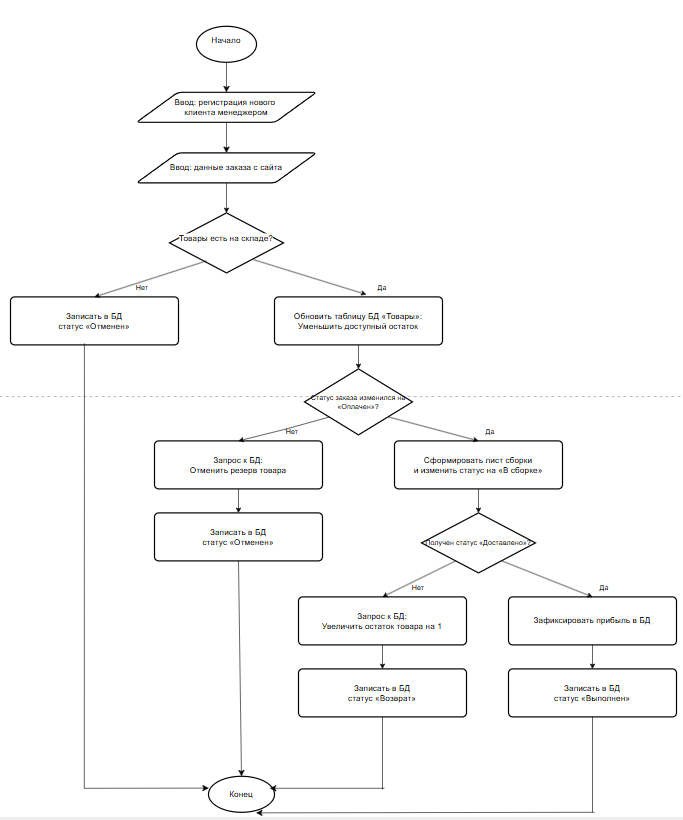

# Лабораторная работа №1

## «Постановка задачи и моделирование процессов информационной системы»

**Тема:** «Учёт заказов в интернет-магазине»

**Выполнила:** студентка группы 26-ИВТ-4-2 Новоселова Карина Сергеевна

---

## 1. Постановка задачи

### 1.1 Описание предметной области

Система «Учёт заказов в интернет-магазине» предназначена для хранения и обработки информации о заказах, товарах, зарегистрированных клиентах, оплате и доставке. Система автоматизирует процесс обработки заказов в базе данных (БД): от момента ручной регистрации нового клиента менеджером в системе и оформления заказа через сайт до автоматического изменения электронных статусов при доставке и фиксации прибыли.

**Основные объекты системы:**

- **Заказ** — идентификатор (ID), дата оформления, привязка к ID клиента, список товаров, итоговая сумма, способ оплаты, текущий статус в БД, дата доставки.
- **Товар** — идентификатор, наименование, категория, цена, доступный остаток на складе.
- **Клиент** — идентификатор (ID), ФИО, контактные данные, адрес доставки, созданная менеджером учётная запись, история заказов.
- **Менеджер** — сотрудник, выполняющий первичную регистрацию клиентов в базе данных, переводящий заказы в статус сборки и контролирующий отчётность.
- **Склад** — подсистема учёта, хранящая данные о наличии товаров, автоматическом резервировании и формировании электронных листов сборки.
- **Служба доставки** — подсистема, передающая в БД статус исполнения («Доставлено» или «Отказ»).
- **Оплата** — способ расчёта (онлайн или при получении), статус подтверждения платежа в системе.

**Связи между объектами:** один зарегистрированный менеджер может внести в базу данных несколько клиентов; один клиент может оформить несколько заказов; один заказ может содержать несколько товаров; каждый заказ в БД строго относится к определённому клиенту, менеджеру и выбранному способу оплаты.

### 1.2 Цели системы

Основная цель системы — автоматизация учёта заказов интернет-магазина и упрощение работы с информацией о заказах, товарах и клиентах.

Система должна обеспечивать:

- хранение данных о заказах и клиентах;
- хранение информации о товарах и остатках на складе;
- регистрацию менеджером новых клиентов в базе данных;
- ведение истории заказов;
- просмотр информации о заказе и его статусе;
- формирование списка заказов для сборки и доставки;
- редактирование и удаление записей, сохранность и целостность данных.

### 1.3 Пользователи системы и их роли

- **Клиент** — основной пользователь системы. Может оформлять заказы, оплачивать их, отслеживать статус, отменять заказы, просматривать историю заказов.
- **Менеджер** — отвечает за первичную регистрацию и заведение карточки клиента в базе данных, обработку заказов, фиксацию прибыли и ведение отчётности.
- **Склад** — отвечает за наличие и сборку товаров. Может проверять наличие товара, бронировать товары, собирать и упаковывать заказы, передавать их в доставку, оформлять возврат товара.
- **Служба доставки** — доставляет заказ клиенту.

### 1.4 Основные функции системы

1. Регистрация клиента менеджером в базе данных
2. Ввод данных о заказе
3. Авторизация пользователя
4. Проверка данных
5. Проверка наличия товара на складе
6. Регистрация оплаты
7. Сохранение заказа в базе данных
8. Сборка и отправка заказа
9. Формирование отчёта

---

## 2. Анализ и моделирование процессов

### 2.1 Диаграмма вариантов использования

Диаграмма вариантов использования отражает взаимодействие актёров (Клиент, Менеджер, Склад, Служба доставки) с функциями системы.

- Актёр **Менеджер** взаимодействует с вариантами использования «Регистрация нового клиента», «Зафиксировать прибыль» и «Вести отчётность». Менеджер является ключевым сотрудником, который заводит карточку покупателя в базу данных перед оформлением сделки.
- Актёр **Клиент** взаимодействует с вариантами использования «Оформить заказ на сайте», «Оплатить заказ», «Отследить статус заказа» и «Отменить заказ». Оформление заказа расширяется (*Extends*) оплатой заказа. Оплата заказа, отслеживание статуса и отмена заказа включают в себя (*Include*) обязательный поиск заказа в базе данных.
- Актёр **Служба доставки** взаимодействует с вариантом использования «Доставить заказ клиенту».
- Актёр **Склад** взаимодействует с вариантами использования «Проверить наличие товара», «Забронировать товар», «Собрать и упаковать заказ», «Передать заказ в доставку» и «Оформить возврат товара». Передача заказа в доставку включает (*Include*) контроль сроков доставки, а оформление возврата товара расширяется (*Extends*) контролем сроков доставки.

### 2.2 Блок-схема оформления заказа

На Рисунке 2 показана блок-схема работы программы при обработке заказов. Система управляет процессом и меняет статусы в базе данных (БД):

1. Сначала менеджер вводит в систему данные для регистрации нового клиента, и программа создаёт его карточку в базе данных.
2. Затем система принимает данные самого заказа с сайта.
3. Программа автоматически проверяет по базе данных, есть ли выбранный товар на складе.
   - Если товара нет, система сразу ставит заказу статус «Отменён» и завершает работу.
   - Если товар есть, программа временно бронирует его в базе данных.
4. Далее проверяется условие: изменился ли статус заказа на «Оплачен».
   - Если оплата не пришла, система отменяет бронь товара, ставит статус «Отменён» и процесс завершается.
   - Если оплата подтверждена, система ставит статус «В сборке» и автоматически отправляет список товаров на склад.
5. После доставки проверяется следующее условие: пришёл ли в БД статус «Заказ вручён».
   - Если клиент отказался, программа сама возвращает товар на склад (+1 к остаткам), меняет статус заказа на «Возврат» и завершает работу.
   - Если заказ успешно вручён, система записывает прибыль в БД, ставит финальный статус «Выполнен» и закрывает процесс.

---

## 3. Вывод

В ходе лабораторной работы была поставлена задача и смоделированы процессы информационной системы «Учёт заказов в интернет-магазине». Была описана предметная область, определены объекты системы, её пользователи и основные функции, включая подсистему регистрации новых клиентов менеджером. Построены Use Case диаграмма (взаимодействие актёров с системой через связи «Include» и «Extend») и системная блок-схема (пошаговый алгоритм обработки заказа).

В результате получены практические навыки постановки задачи и моделирования процессов информационной системы со стороны работы программы и базы данных, которые могут быть использованы при дальнейшей разработке программного обеспечения.