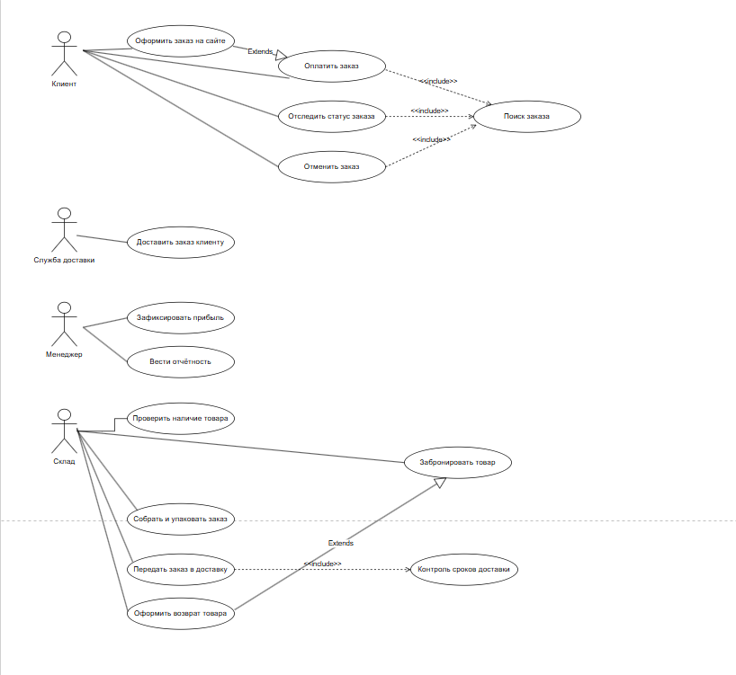

# Лабораторная работа №1

## «Постановка задачи и моделирование процессов информационной системы»

**Тема:** «Учёт заказов в интернет-магазине»

**Выполнила:** студентка группы 26-ИВТ-4-2 Новоселова Карина Сергеевна

---

## 1. Постановка задачи

### 1.1 Описание предметной области

Система «Учёт заказов в интернет-магазине» предназначена для хранения и обработки информации о заказах, товарах, клиентах, оплате и доставке. Система автоматизирует процесс оформления и обработки заказов: от момента оформления на сайте до вручения клиенту и фиксации прибыли.

**Основные объекты системы:**

- **Заказ** — идентификатор, дата оформления, клиент, список товаров, сумма, способ оплаты, статус, дата доставки.
- **Товар** — идентификатор, наименование, категория, цена, остаток на складе.
- **Клиент** — идентификатор, ФИО, контактные данные, адрес доставки, история заказов.
- **Менеджер** — сотрудник, обрабатывающий заказы и формирующий отчётность.
- **Склад** — данные о наличии и бронировании товаров, сборке и упаковке заказов.
- **Служба доставки** — данные о доставке заказа клиенту.
- **Оплата** — способ оплаты (онлайн или при получении), статус оплаты.

**Связи между объектами:** один клиент может оформить несколько заказов, один заказ может содержать несколько товаров, каждый заказ относится к определённому клиенту, менеджеру и способу оплаты.

### 1.2 Цели системы

Основная цель системы — автоматизация учёта заказов интернет-магазина и упрощение работы с информацией о заказах, товарах и клиентах.

Система должна обеспечивать:

- хранение данных о заказах и клиентах;
- хранение информации о товарах и остатках на складе;
- регистрацию новых заказов;
- ведение истории заказов;
- просмотр информации о заказе и его статусе;
- формирование списка заказов для сборки и доставки;
- редактирование и удаление записей;
- сохранность и целостность данных.

### 1.3 Пользователи системы и их роли

- **Клиент** — основной пользователь системы. Может оформлять заказы, оплачивать их, отслеживать статус, отменять заказы, просматривать историю заказов.
- **Менеджер** — отвечает за обработку заказов. Может фиксировать прибыль и вести отчётность.
- **Склад** — отвечает за наличие и сборку товаров. Может проверять наличие товара, бронировать товары, собирать и упаковывать заказы, передавать их в доставку, оформлять возврат товара.
- **Служба доставки** — доставляет заказ клиенту.

---

## 2. Анализ и моделирование процессов

### 2.1 Диаграмма вариантов использования

Диаграмма вариантов использования отражает взаимодействие актёров (Клиент, Менеджер, Склад, Служба доставки) с функциями системы.

- Актёр **Клиент** взаимодействует с вариантами использования «Оформить заказ на сайте», «Оплатить заказ», «Отследить статус заказа», «Отменить заказ». Оформление заказа расширяется (*Extends*) оплатой заказа. Оплата заказа, отслеживание статуса и отмена заказа включают (*Include*) поиск заказа.
- Актёр **Служба доставки** взаимодействует с вариантом использования «Доставить заказ клиенту».
- Актёр **Менеджер** взаимодействует с вариантами использования «Зафиксировать прибыль» и «Вести отчётность».
- Актёр **Склад** взаимодействует с вариантами использования «Проверить наличие товара», «Забронировать товар», «Собрать и упаковать заказ», «Передать заказ в доставку», «Оформить возврат товара». Передача заказа в доставку включает (*Include*) контроль сроков доставки, а оформление возврата товара расширяется (*Extends*) контролем сроков доставки.

### 2.2 Блок-схема оформления заказа

Сначала система получает данные заказа с сайта. Затем она проверяет, есть ли товары на складе.

- Если товаров нет — система устанавливает статус «Отменён» и завершает процесс.
- Если товары есть — система бронирует их на складе.

Далее проверяется, оплачен ли заказ:

- если нет — бронь снимается, устанавливается статус «Отменён», процесс завершается;
- если да — выполняется сборка и отправка заказа.

После доставки проверяется, успешно ли вручён заказ:

- если нет — товар возвращается на склад (+1 к остаткам), устанавливается статус «Возврат», процесс завершается;
- если да — фиксируется прибыль в БД, устанавливается статус «Выполнен», процесс завершается.