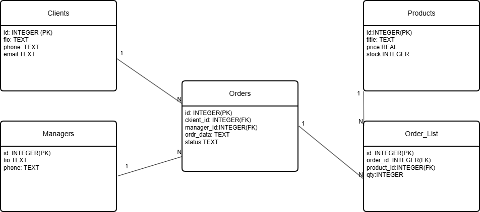
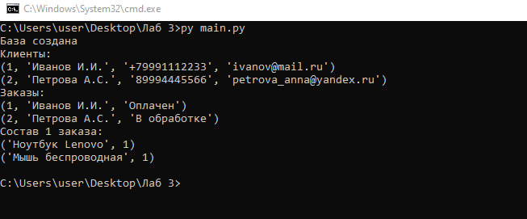
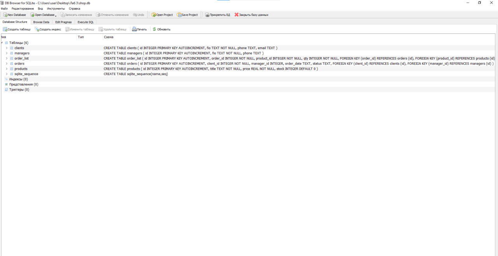
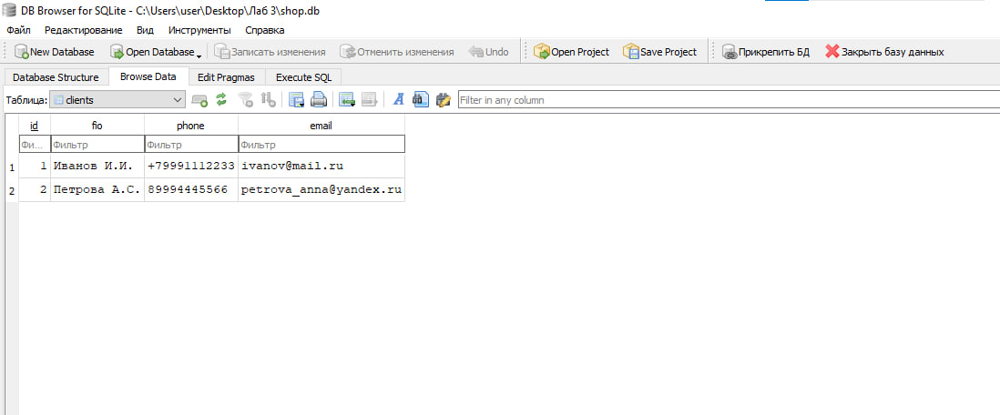

# Лабораторная работа №3: Проектирование и реализация базы данных

**Тема:** Учёт заказов в интернет-магазине
**Выполнила:** студентка группы 26-ИВТ-4-2 Новоселова Карина Сергеевна

## 1. Проектирование базы данных (ER-диаграмма)

В ходе работы была спроектирована база данных для интернет-магазина на основе предметной области из Лабораторной работы №1. Основные сущности: Клиенты, Менеджеры, Товары, Заказы и Состав заказов (связующая таблица).

**Связи между сущностями:**
*   Один менеджер может зарегистрировать много клиентов (1:N, реализовано через связь в коде).
*   Один клиент может оформить много заказов (1:N).
*   Один заказ содержит много товаров (реализовано через таблицу Order_List, связь N:M).
*   Один товар может встречаться в разных заказах (N:M через Order_List).

## 2. Реализация базы данных

База данных создана в СУБД SQLite. Для создания таблиц и добавления тестовых данных использовался SQL-скрипт `schema.sql`.
Слой доступа к данным реализован на языке Python в файле `main.py` с использованием встроенной библиотеки `sqlite3`.

**Структура таблиц:**
*   `clients` (id, fio, phone, email) — Клиенты.
*   `managers` (id, fio, phone) — Менеджеры.
*   `products` (id, title, price, stock) — Товары (склад).
*   `orders` (id, client_id, manager_id, order_date, status) — Заказы.
*   `order_list` (id, order_id, product_id, qty) — Состав заказа (связь заказов и товаров).

## 3. Результаты работы

В результате выполнения программы `main.py` была создана база данных `shop.db`, заполнены таблицы и выполнен тестовый вывод данных с использованием SQL-запросов (в том числе с JOIN).

**Скриншот выполнения скрипта (консоль):**
 

**Скриншот структуры БД (DB Browser):**

**Скриншот данных в таблице (DB Browser):**
